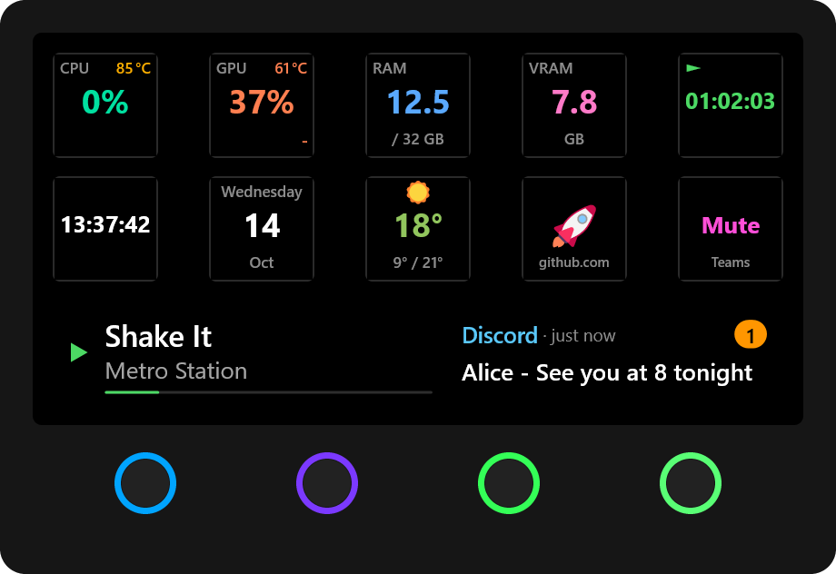
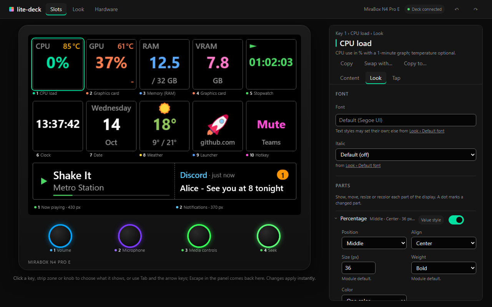
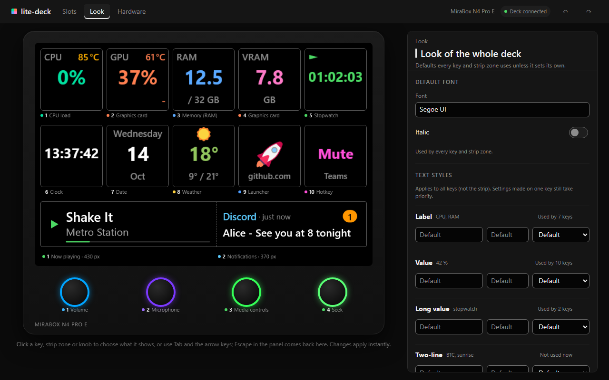

# lite-deck

lite-deck is a small native Windows program that drives the **MiraBox N4 Pro E** stream controller
(USB VID `0x5548`, PID `0x1021`) in place of the vendor's StreamDock software. It runs in the
background with a tray icon, draws the 10 keys, the touch strip and the knob rings itself, and is
configured from a web page served on `127.0.0.1`.

It is written in C++20 against the Win32, Direct2D/DirectWrite and WinRT APIs. There is no Electron,
no .NET and no plugin runtime. The daemon is a single executable that uses about 20 MB of private memory.

> lite-deck is an independent project. It is not affiliated with, endorsed by or supported by MiraBox.
> "MiraBox" and "StreamDock" are names of their respective owners and are used here only to say
> which hardware and software this project works with.

lite-deck was called *libre-deck* before. An installation under that name is removed by the
installer, and its data folder is moved at the first start (see [Install](#install)).

## Features

### The device

| Part | What lite-deck does with it |
|---|---|
| 10 keys (112 × 112 px LCD) | One module per key. Tap, long press (500 ms), press and release reach the module. |
| Touch strip (800 × 112 px) | Split into 1 to 8 zones (at least 60 px wide; the widths add up to 800). One module per zone. Tap, long touch and left/right swipes reach the zone under the finger. |
| 4 knobs with RGB rings | One module per knob. Turn and press reach the module, which can set its ring colour (for example, red when the microphone is muted). |

Screen and ring brightness, and a default colour for each ring, are set in the web UI's **Hardware**
tab. When the session is locked or the PC goes to sleep, lite-deck puts the deck to sleep, and it
wakes the deck again afterwards.

### Key modules

| Module | Shows |
|---|---|
| `clock` | Local time, HH:MM, seconds optional, on the same line or smaller on a line below (*Seconds on a line below*). |
| `date` | Weekday, day and month. |
| `cpu_load` | Total CPU load in % with a 60-second graph. Can also show the CPU temperature in the top-right corner. |
| `cpu_temp` | CPU temperature (°C) with a 60-second graph, read from the optional sensors service. |
| `ram` | Memory used (GB of total), with warning and critical thresholds. |
| `gpu` | One measure of a graphics card: VRAM used, temperature, or usage (busiest engine, as Task Manager shows it) with a graph. "-" when the driver does not report it. |
| `weather` | Current temperature, conditions icon and today's min/max for a city ([Open-Meteo](https://open-meteo.com/)). The temperature can be coloured by how far it is from the seasonal normal. |
| `sun` | Next sunrise and sunset for a city, computed on the PC (NOAA algorithm) and checked online from time to time. Shows "Polar day" or "Polar night" when there is no sunrise or sunset. |
| `crypto_gold` | Bitcoin and gold prices in EUR ([CoinGecko](https://www.coingecko.com/)). Tap to refresh. |
| `net_speed` | Download rate (B/s to GB/s, or bits) with a 60-second graph, and the upload rate in the top-right corner. All physical adapters, or one by name. |
| `ping` | Latency to a host (1.1.1.1 by default, a name, or `gateway`), the loss over the last 20 probes and a 60-second graph. |
| `disk` | One drive: space used (% and used / total GB, with warning and critical levels on the free space), or its read and write rates with a graph. |
| `http_sensor` | One value from a JSON answer over http or https (a Home Assistant sensor, a NAS), with its label, unit, an optional header for a token, and optional thresholds. |
| `launcher` | Press to start a program with its arguments, open a URL, a file or a folder with its default program, or run a command line through `cmd` or PowerShell (hidden or in a window). Shows the program's icon, a picture, an emoji or a text. Can bring the running program to the front instead of starting it again. Runs with your rights: lite-deck starts an exe itself and never elevates it (one that requires administrator rights fails). It never asks for elevation, but a shortcut, an installer (`.msi`) or a console (`.msc`) that requires it is opened by Windows, which then shows its UAC prompt. |
| `hotkey` | Press to send key combinations (`Ctrl+Shift+M`, or up to 8 in a row: `Win+Shift+S, Enter`) or to type a text, to the window that has the focus. Keys do not reach a window run as administrator. |
| `stopwatch` | Tap to start or stop. A long press writes the time to a log file (`Documents\stopwatch_log.txt` by default, in the same format as StreamDock's), and a long press at zero shows the total. *Seconds on a line below* shows the hours and minutes large and the seconds underneath. |

When data is out of date (no network, no sensor), modules grey it out (the *stale* state) or show "-".

A tap on a monitor key (`cpu_load`, `cpu_temp`, `ram`, `gpu`, `net_speed`, `disk`, `ping`) opens Task Manager, on `weather` open-meteo.com and on `clock` the Windows Clock app; the *On tap* settings of these keys and `date` choose nothing, Task Manager or any URL, file or program, with the same flash and "!" as the `launcher`.

The `launcher` and `hotkey` keys light up briefly when pressed, and show a red "!" for a moment when
the action fails (the reason is in the log). Placed on a key, a `launcher` runs what its settings
say: anyone who can change your configuration (the config file, or the web UI, which only accepts
this PC, your session token and its own requests) can run commands as you. The log never contains
the arguments, the command line or the typed text, only the kind of action and the program's name.

### Strip zone modules

| Module | Shows |
|---|---|
| `now_playing` | Title and artist of the current Windows media session, a play/pause icon and a progress bar. Long text scrolls. |
| `notifications` | Windows notifications, one at a time, with scrolling. A tap dismisses the current one, and "All clear" shows when there are none. Windows asks once for permission to read notifications. |

### Knob modules

| Module | Turn | Press | Ring |
|---|---|---|---|
| `volume` | Default output volume, in steps (1-10 %) | Mute / unmute | Normal or muted colour |
| `mic` | Default input level | Mute / unmute | Normal or muted colour (red by default) |
| `media` | Next / previous track | Play / pause | Fixed colour |
| `seek` | Moves the current media by `step_s` seconds per notch (1-60). Fast turns add up into one seek. | Nothing | Lit while media is playing |

### Web UI

The configuration page shows a live picture of the deck, using the same images that are sent to the
device, and keeps it in view while you edit. It has three tabs:

- **Slots**: click a key, a strip zone or a knob (or move with the arrow keys) to choose its module
  in a catalogue grouped by category, with a one-line description each. Its panel has a **Content**
  tab (module and settings), a **Look** tab (font and the parts it draws: position, size, weight,
  color) and a **Tap** tab for keys, or a **Ring** tab for knobs. Each inherited value says where it
  comes from, with a link.
- **Look**: the font, the text styles and the status colors of the whole deck. Hovering a row outlines
  the keys it changes.
- **Hardware**: brightness, the default ring colors and the device.

Drag a key onto another to swap them (Ctrl to copy), copy and paste with Ctrl+C and Ctrl+V, drag a
strip zone border to resize. Each change is checked, saved to `config.json` and applied at once, and
only the slots that changed are restarted. Ctrl+Z and Ctrl+Y undo and redo. A refused value is shown
under its field and on the deck. The address keeps your place (`#slots/key-3/look`), so reload and
the browser's back button work.

### Design system

Every key module draws through one key engine, so all keys follow the same rules and can be
adjusted the same way:

- **Per-element settings.** Each module declares its *elements*, such as a label, a value, a unit,
  an icon or a graph. For each element on a slot you can set the size, weight, visibility, row
  (top / middle / bottom, or two lines), alignment (left / centre / right) and colour: a fixed colour,
  the *state* palette, or a *gradient* when the module provides a metric (for example, temperatures
  from blue through white to red).
- **State palette.** Values have a state: normal, warning, critical, idle or stale. Thresholds,
  with hysteresis, are module settings, such as the CPU temperature warning level. The four state
  colours are set once for the whole deck.
- **Text styles.** Every key text has a style: *label*, *value*, *long value*, *two-line*,
  *secondary* or *symbol*. The web UI's Look tab sets the font, size and weight of each style on
  every key at once. A default font and italic setting, and a font per key or zone, are also
  available.

## Screenshots

The deck in the default layout, with a launcher and a hotkey (made-up data):



The configuration page:





These pictures are generated: `build\Debug\lite-deck-tests.exe -tc="doc: deck image" --no-skip`
composes the deck from the reference images of `tests/golden` (the key engine's own output), then
`node tests/web/readme.edge.js` takes the page with Microsoft Edge on the mock server of `tests/web`.

## Requirements

- Windows 10 or 11, 64-bit (x64).
- A MiraBox N4 Pro E (VID `0x5548`, PID `0x1021`). Only the N4 Pro E is supported today. To add
  another model, see [docs/adding-a-device.md](docs/adding-a-device.md); contributions from people who
  own other stream deck models are welcome.
- For the CPU temperature only: an AMD CPU of family 17h to 1Ah (Ryzen, Zen 1 to Zen 5) and the
  [PawnIO](https://pawnio.eu/) driver. Everything else works without them.
- StreamDock must not be running at the same time, because both programs would compete for the
  device.

## Install

### From a release

Download `lite-deck-<tag>-x64.zip` (for example `lite-deck-v1.0.0-x64.zip`) from the project's
GitHub Releases page and extract it. It contains the `lite-deck` folder described below. Then
follow step 2 of the next section.

Releases are built by GitHub Actions (`.github/workflows/release.yml`): pushing a tag such as `v1.0.0`
runs `scripts/package.ps1` (Release build, unit tests, the signed PawnIO setup, the installer scripts
and the notices), zips `dist\lite-deck` and publishes it as a GitHub Release.

### From source

1. Build the distribution folder (see [Build from source](#build-from-source) for the requirements):

   ```powershell
   powershell -NoProfile -ExecutionPolicy Bypass -File scripts/package.ps1
   ```

   This builds Release in `build\dist-build`, runs the tests (`-SkipTests` skips them), downloads the
   official `PawnIO_setup.exe` and checks its signature, then fills `dist\lite-deck`.

2. From **your own Windows account**, open PowerShell **as administrator** and run the installer
   from that folder. Use the UAC prompt of your own account. If you use a different administrator
   account, the autostart entry goes to that account instead of yours.

   ```powershell
   powershell -NoProfile -ExecutionPolicy Bypass -File dist\lite-deck\install.ps1
   ```

### What the installer does

- It removes an older *libre-deck* installation if one is present (its daemon, service, folder and
  autostart entry). It does not touch `%APPDATA%`.
- It asks whether to install **PawnIO**, which is only needed for the CPU temperature. PawnIO is a
  signed kernel driver, and it is installed silently with its official setup, after the signature is
  checked. Nothing is installed without your consent. Without a console to ask, PawnIO is not
  installed.
- It copies the files to `C:\Program Files\lite-deck`.
- With PawnIO present, it creates and starts the `LiteDeckSensors` service (LocalSystem, automatic
  start). This service reads the CPU temperature and publishes it to the daemon through read-only
  shared memory.
- It adds `lite-deck` to your account's autostart (`HKCU\...\Run`).
- If StreamDock starts with Windows, it offers to disable StreamDock's autostart. Uninstalling
  turns it back on.
- It starts the daemon without administrator rights.

Running `install.ps1` again updates an existing installation.

| Switch | Effect |
|---|---|
| `-InstallPawnIO` | Install PawnIO without asking. |
| `-NoPawnIO` | Do not install PawnIO and do not ask. Cannot be combined with `-InstallPawnIO`. |
| `-DisableStreamDock` | Disable StreamDock's autostart without asking. |
| `-KeepStreamDock` | Leave StreamDock's autostart alone without asking. |

### Uninstall

As administrator:

```powershell
powershell -NoProfile -ExecutionPolicy Bypass -File "C:\Program Files\lite-deck\uninstall.ps1"
```

This stops the daemon, deletes the service, the autostart entry and `C:\Program Files\lite-deck`, and
turns StreamDock's autostart back on if the installer had disabled it. PawnIO stays installed, because
other software may use it, unless you add `-RemovePawnIO`. Your configuration in
`%APPDATA%\lite-deck` is kept. Delete that folder by hand if you no longer need it.

## Configuration

- **Web UI.** Left-click the tray icon, or right-click it and choose **Configure…**. Your browser
  opens `http://127.0.0.1:7878/?t=…`. The token in the link is exchanged for a session cookie, and
  it changes every time the daemon starts, so a page left open from a previous run shows "Session
  expired". Starting `lite-deck.exe` again while it runs opens the page as well.
- **Config file.** `%APPDATA%\lite-deck\config.json`. On the first run it is created with a default
  layout:
  - top row: CPU, GPU usage, RAM, VRAM and stopwatch;
  - bottom row: clock, date, weather, sun and BTC/gold;
  - knobs: volume, microphone, media and seek;
  - strip: now playing and notifications.

  You can edit the file by hand, and it is reloaded 300 ms after you save it. If it is invalid,
  the previous configuration stays active, the tray icon shows a warning and the web UI lists the
  errors. Saving from the web UI rewrites the file and drops any comments, but keeps unknown keys.
- **Web port.** `"web": { "port": 7878 }` in `config.json`, applied at the next start. If the port is
  in use, the daemon runs without the web UI and the tray menu says so.
- **Module state.** `%APPDATA%\lite-deck\state.json` stores data that modules keep between runs, such
  as geocoded cities, seasonal normals and the stopwatch.
- **Logs.** `%APPDATA%\lite-deck\logs\lite-deck.log` (rotated at 1 MB, 3 files kept). The sensors
  service logs to `C:\Program Files\lite-deck\logs\sensors.log`.
- **Simulator.** `lite-deck.exe --simulate` runs without the device and writes each frame of the
  active device (the one plugged in, else the one named by `device.model`, else the N4 Pro) as an
  image to `%APPDATA%\lite-deck\sim`. To inject input, drop an `inject.txt` file in that folder,
  with lines such as `keydown N`, `keyup N`, `turn K ±1`, `press K`, `touchdown X`, `touchmove X Y`,
  `touchup` or `wait MS`.

The scripting interface of the web UI is described in [docs/web-api.md](docs/web-api.md).

## Privacy and network

lite-deck has no telemetry, no account and no update check. The web UI listens on `127.0.0.1` only.
The daemon goes online only for the modules in the table below, only over HTTPS (plain http only for
an `http_sensor` URL you type), with the user agent `lite-deck/1.0`.

**What a fresh install contacts.** The default layout places three of these modules on the bottom
row: `weather`, `sun` and `crypto_gold`.

- `crypto_gold` contacts CoinGecko each time the daemon starts, then every 5 minutes and on each
  tap.
- `weather` and `sun` start without a city (the key shows "City?") and send nothing until you type
  one in their settings.
- A tap on the weather key opens `https://open-meteo.com` in your browser (its default tap action):
  only your browser contacts that site, and only when you tap.

To turn this off, put another module on those keys or empty them: in the web UI, pick **Nothing
(empty)** in the module catalogue; in `config.json`, change the key's `module` or set the key to
`null`. The weather key's **On tap** setting can be set to **Nothing**. With none of the modules
below placed, the daemon makes no network request.

| Module | Service | What is sent | When |
|---|---|---|---|
| `weather`, `sun` | Open-Meteo geocoding (`geocoding-api.open-meteo.com`) | The city name you typed | Once per city. The result is cached in `state.json`. |
| `weather` | Open-Meteo forecast (`api.open-meteo.com`) | Latitude/longitude (4 decimals) | Every 15 minutes |
| `weather` | Open-Meteo historical archive, ERA5 (`archive-api.open-meteo.com`) | Latitude/longitude and a 30-year date range | At most every 30 days, only when the temperature colour is "gap to the seasonal normal" (the default) |
| `sun` | Open-Meteo forecast (`api.open-meteo.com`) | Latitude/longitude | Every `verify_days` days (default 7, 0 = never), to compare the sunrise and sunset times computed on the PC with the online ones |
| `crypto_gold` | CoinGecko (`api.coingecko.com`) | Nothing specific to you (a fixed request for BTC and Tether Gold in EUR) | Every 5 minutes, and on tap |
| `ping` | The host you set: Cloudflare DNS (`1.1.1.1`) by default | ICMP echo requests (32 bytes), and a DNS lookup when the host is a name | Every `interval_s` seconds (default 2) |
| `http_sensor` | The URL you set | A GET of that URL, with the header you set (for example a token) | Every `interval_s` seconds (default 30), less often after failures |

The `now_playing`, `notifications`, `volume`, `mic`, `media`, `seek`, `launcher` and `hotkey`
modules use local Windows APIs only (a `launcher` that opens a URL hands it to your browser). `scripts/package.ps1` downloads `PawnIO_setup.exe` from GitHub when you build a
distribution folder. The installed program never does.

## Resource use

These figures were measured over one hour on a Ryzen 7 7700X with the default layout, the web UI open,
and real music and notifications:

| | `lite-deck.exe` | `lite-deck-sensors.exe` |
|---|---|---|
| Private memory | about 19-23 MB, stable | about 7 MB |
| CPU | about 0.6 % of one core when nothing scrolls, up to about 4 % while the strip scrolls | negligible (one sensor read per second) |

Most of the CPU time goes to scrolling text on the strip. A zone whose text is too long redraws
the strip at 30 frames per second for the first few passes, then at 20. Keys only redraw when their
content changes.

## Build from source

Requirements:

- Visual Studio 2022 or later with the **Desktop development with C++** workload, which includes MSVC,
  the Windows SDK, CMake and Ninja. The project is developed with Visual Studio 2026 (MSVC 19.50).
- CMake 3.25 or later. The copy bundled with Visual Studio works.

```powershell
# Debug build and unit tests (build\Debug\lite-deck-tests.exe)
powershell -NoProfile -ExecutionPolicy Bypass -File scripts/build.ps1 -Test

# Release build
powershell -NoProfile -ExecutionPolicy Bypass -File scripts/build.ps1 -Config Release

# Distribution folder dist\lite-deck (Release build in build\dist-build, tests included)
powershell -NoProfile -ExecutionPolicy Bypass -File scripts/package.ps1
```

`build.ps1` finds Visual Studio with `vswhere`, enters its developer shell, and configures with
Ninja into `build\<Config>`. `-TestArgs` passes arguments to the doctest runner, for example
`-TestArgs '-tc=golden*'`. Tests that need real hardware, the network or a manual check are
marked `skip` and do not run by default. The installer helpers have their own self-test, which needs no
administrator rights:
`powershell -NoProfile -ExecutionPolicy Bypass -File scripts/test-install-lib.ps1`.

To write your own module, see [docs/writing-a-module.md](docs/writing-a-module.md).
To add support for another device, see [docs/adding-a-device.md](docs/adding-a-device.md).

## Project layout

| Path | Contents |
|---|---|
| `src/main.cpp` | Daemon entry point: single instance, event loop, device, deck, web UI, tray. |
| `src/app/` | Tray window, data folder, process helpers. |
| `src/core/` | Event loop, timers, config parsing and validation, config file watcher, HTTP client, state store, log. |
| `src/device/` | The device contract and registry, HID access, hot-plug, the simulator; one folder per driver (`n4pro/`). |
| `src/layout/` | The `Deck`: slots, input routing, gestures, rendering passes. |
| `src/render/` | Direct2D/DirectWrite drawing, the key engine and the appearance resolution. |
| `src/modules/` | The modules and their shared helpers (`common/`). |
| `src/web/` | Embedded web server, HTTP API and the web UI's assets. |
| `src/sensors/`, `sensors-service/` | CPU temperature through PawnIO, and the `LiteDeckSensors` Windows service. |
| `tests/` | doctest unit tests, fakes, and reference images (`tests/golden`). |
| `scripts/` | Build, package, install and uninstall scripts. |
| `proto/` | Protocol notes ([PROTOCOL.md](proto/PROTOCOL.md)) and the Python probes used to work them out. |
| `third_party/` | Vendored libraries and the PawnIO module (see [THIRD_PARTY_NOTICES.md](THIRD_PARTY_NOTICES.md)). |

## Contributing

Bug reports and pull requests are welcome. Please:

- keep each change focused, and add or update tests (`scripts/build.ps1 -Test` must pass);
- never regenerate the reference images in `tests/golden` just to make a test pass. A change to
  the rendering should be deliberate and visible in the review;
- follow the existing style: C++20, `/W4` clean, no threads or blocking calls in modules;
- write comments that describe what the code does, in English.

## Licence

lite-deck is free software: you can redistribute it and/or modify it under the terms of the
GNU General Public License, version 3. See [LICENSE](LICENSE).

It includes or uses third-party components under their own licences: nlohmann/json, cpp-httplib,
doctest (tests only), the PawnIO `AMDFamily17` module, and the PawnIO driver installer. See
[THIRD_PARTY_NOTICES.md](THIRD_PARTY_NOTICES.md).
