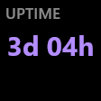

# Writing a module

A *module* is what a key, a knob or a strip zone runs: the clock, the volume knob, the "now playing"
zone, and so on. This guide covers the module API in `src/modules/`, the key engine in
`src/render/`, and how modules are tested.

## How modules are built

**Modules are compiled into the daemon.** lite-deck has no plugin DLL, no stable ABI and no
scripting runtime. A module is C++ source in `src/modules/<id>/`, built into `lite-deck.exe` like the
rest of the code. To add one, you change the source tree and rebuild. The API below is stable inside
the code base, not across binaries.

These are the files to touch:

| Step | File |
|---|---|
| Write the module | `src/modules/<id>/<id>.h`, `src/modules/<id>/<id>.cpp`. CMake picks up any `src/**/*.cpp`, so `CMakeLists.txt` does not change. |
| Make it visible | Add `#include "modules/<id>/<id>.h"` to `src/modules/all_modules.h`. |
| Register it | Add `<id>_module_info(),` to the list in `module_registry()` in `src/modules/registry.cpp`. |
| Test it | Add `tests/test_<id>.cpp`. Update the registry-wide checks in `tests/test_appearance_modules.cpp` (module count, text roles; see [Testing](#testing)). |

The web UI needs no change. It reads `GET /api/modules` and builds the module's settings form and
element editor from the `ModuleInfo`.

## The interface (`src/modules/module.h`)

### `ModuleInfo`: what the module declares

```cpp
struct ModuleInfo {
  std::string id;                       // stable: written in config.json
  std::string name;                     // shown in the web UI: short ("Graphics card", not "GPU (VRAM / ...)")
  std::string description;              // one line in the module catalogue, at most 70 characters
  std::string category;                 // System, Time, Weather & sky, Media & sound, Actions or Online data
  std::string hue;                      // "#rrggbb": the page's accent while it is selected; "" = neutral
  std::vector<SlotKind> slots;          // SlotKind::Key, SlotKind::Knob, SlotKind::StripZone
  nlohmann::json settings_schema;       // {"fields": [...]}, see below
  std::vector<ElementSpec> elements;    // texts, icons, graphs the user can restyle (keys, strip)
  std::vector<RingStateSpec> ring_states;  // knobs: one entry per ring colour state
  std::function<std::unique_ptr<Module>()> create;  // the factory: one instance per placed slot
  std::function<std::optional<std::string>(const nlohmann::json&)> check;  // optional, see below
  bool allows(SlotKind kind) const;
};
```

Each module exposes one free function `ModuleInfo <id>_module_info()`, and `registry.cpp` lists them.
`id` is a key in `config.json`, so do not rename it after release. `name`, `description`, `category`
and `hue` only feed the web UI's module catalogue (`GET /api/modules`); the hue is the module's main
colour on the deck (the CPU green, the GPU coral), so the page and the deck agree. A test checks that
every module has a description, one of the six categories and a valid hue.

### `Module`: what each instance does

```cpp
class Module {
public:
  virtual void start(ModuleContext& ctx, const nlohmann::json& settings) = 0;  // settings already validated
  virtual void on_event(const InputEvent&) {}
  virtual void render(Canvas& canvas) = 0;   // only called after invalidate(); canvas is the slot size
  virtual bool animating() const { return false; }       // true: re-rendered at 30 fps while true
  virtual bool slow_animation() const { return false; }  // while animating: 20 fps instead of 30
};
```

The lifecycle of an instance:

1. `create()` builds an instance when the slot is placed, at startup or when the configuration
   changes.
2. `start(ctx, settings)` runs once. The settings have already passed the schema, so every field is
   present and has the right type. Start timers, read saved state and draw a first state here.
3. `on_event()` receives the input for its slot. `render()` runs after the module calls
   `ctx.invalidate()`, at most once per render pass.
4. The instance is destroyed when the slot is removed, when its module changes, or when its settings
   change. A change of settings means a new instance. A change of appearance only (font, element
   size or colour) keeps the instance and redraws it. Timers and posted callbacks are cancelled
   before the destructor runs.

### Events

```cpp
enum class EventKind { Press, Release, Tap, LongPress, Rotate, SwipeLeft, SwipeRight };
struct InputEvent { EventKind kind; int delta = 0; int x = 0; };
```

| Slot | Events |
|---|---|
| Key | `Press` on key down, `Release` on key up. `LongPress` fires once the key has been held for 500 ms. `Tap` comes after `Release` only when no `LongPress` fired. |
| Knob | `Rotate` with `delta` = the signed number of notches turned (negative counter-clockwise, positive clockwise), and `Press`. The N4 Pro sends one event per notch (`-1` or `+1`); another device may report several notches in one event, so step `abs(delta)` times. |
| Strip zone | `Tap`, `LongPress`, `SwipeLeft` and `SwipeRight`, sent to the zone where the touch started. `x` is the touch position from the zone's left edge. |

### `ModuleContext`: services from the core

```cpp
class ModuleContext {
public:
  virtual TimePoint now() const = 0;                                       // steady clock
  virtual TimerId at(TimePoint when, std::function<void()> fn) = 0;        // one-shot timer
  virtual TimerId every(Duration period, std::function<void()> fn) = 0;    // periodic timer
  virtual void cancel(TimerId id) = 0;
  virtual void post(std::function<void()> fn) = 0;   // run later on the loop thread
  virtual Poster poster() = 0;                       // thread-safe handle for other threads
  virtual void invalidate() = 0;                     // "my rendering changed"
  virtual void set_ring_color(Rgb color) = 0;        // knobs only; ignored elsewhere
  virtual void clear_ring_color() = 0;               // back to the ring colour of the Device panel
  virtual void http_get(const HttpRequest& request, std::function<void(const HttpResponse&)> done) = 0;
  void http_get(const std::string& url, std::function<void(const HttpResponse&)> done);  // https, shared lane
  virtual nlohmann::json load_state() = 0;           // this slot's persisted state (null if none)
  virtual void save_state(const nlohmann::json& state) = 0;
};
```

- **Timers.** `Duration` is `std::chrono::milliseconds`. Every timer of a module is cancelled when
  the instance is destroyed, so a callback can safely capture `this`.
- **`invalidate()`.** Call it only when what the slot shows has really changed. Each call costs a
  render and a JPEG upload to the device. Knobs have no screen, so their invalidations are ignored.
- **`http_get()`.** An asynchronous GET through WinHTTP: 10 s timeouts, a 1 MB body cap
  (`HttpResponse::error == kResponseTooLarge` above it), and the user agent `lite-deck/1.0`. `done`
  runs on the loop thread, and it is dropped if the module was destroyed in the meantime (a request
  still waiting for a worker is then never sent). Check `r.ok()`, which means no transport error and
  a 2xx status. Build query strings with `url_encode()` from `core/http.h`. Any online service you
  add must be listed in the README's privacy section.

  Pass a url for a plain https request, or an `HttpRequest` (`core/http.h`) for more:

  ```cpp
  HttpRequest req{.url = url_,                               // the only required field
                  .allow_plain_http = url_.starts_with("http://"),  // default: https only
                  .lane = HttpLane::Isolated};               // default: HttpLane::Shared
  if (!name.empty()) req.header.emplace(name, value);       // one extra header, such as a token
  ctx_->http_get(req, [this](const HttpResponse& r) { on_response(r); });
  ```

  - `header`: one extra request header. Check it first with `valid_http_header()`, or the request
    fails with `"invalid header"`. Its value is a secret: it is never logged, and redirects are not
    followed when a header is set, so it only goes to the host of the url.
  - `allow_plain_http`: without it, an `http://` url fails with `"https required"`. Allow it only
    for a host the user typed (a sensor on the LAN), never for a service the module chooses.
  - `lane`: the well-known public APIs (weather, sun, prices) share one worker thread, so keep their
    requests rare (minutes apart). A request to a host the user typed, which may not answer and hold
    a worker for the whole timeout, goes on `HttpLane::Isolated`: a small set of workers of its own,
    so it never delays the others. A slot has at most one isolated request in flight; another one
    asked before the first is answered fails at once with `"busy"`. Each lane holds at most
    `WinHttpClient::kMaxQueued` waiting requests (past that, `"busy"` too).

  Log a url only through `url_for_log()`, which keeps the scheme, host and path and drops the
  credentials, the query and the fragment. In tests, `FakeContext::sent` holds every `HttpRequest` a
  module asked (`requests` holds the url and the callback to answer it).
- **State.** `load_state()` and `save_state()` keep a JSON value per slot in
  `%APPDATA%\lite-deck\state.json`, under the key `<module>:<k|n|z><index>`. Use them for what must
  survive a restart, such as a running stopwatch or a geocoded city. Do not use them for settings:
  settings belong in the schema.

### Settings schema (`src/modules/schema.h`)

```json
{"fields": [
  {"key": "city",    "type": "string", "default": "",   "label": "City"},
  {"key": "step",    "type": "int",    "default": 2,    "min": 1, "max": 10, "label": "Step (%)"},
  {"key": "mode",    "type": "enum",   "default": "vram", "label": "Measure",
   "options": [{"value": "vram", "label": "Memory used"}, {"value": "temp", "label": "Temperature"}]},
  {"key": "temp_warn", "type": "number", "default": 75, "min": 0, "max": 120, "label": "Warning at (°C)",
   "group": "thresholds", "show_if": {"field": "mode", "equals": "temp"}},
  {"key": "color",   "type": "color",  "default": "#ffffff", "label": "Color"},
  {"key": "seconds", "type": "bool",   "default": true, "label": "Show seconds"}
]}
```

- The types are `int`, `number`, `bool`, `string`, `secret` (a string the page shows in a password
  field, for a token), `color` (`#rrggbb`) and `enum` (needs `options`).
  `min` and `max` apply to `int` and `number`.
- Every field needs a `default` that passes its own checks. `apply_schema()` reports an invalid
  schema as an error.
- When the configuration is loaded or saved, `apply_schema()` fills missing keys with their
  defaults, drops unknown keys, and refuses wrong values with a message such as
  `step: value too large (max 10)`. The web UI shows that message at `keys[3].settings`. A refused
  configuration is never applied, so `start()` can read every field with `s.at("key")`.
- An optional `"hint"` is shown under the field, and an optional `"placeholder"` is shown as an
  example in an empty text field (`"Ctrl+Shift+M, Enter"`). The label stays a few words (a test caps
  it at 32 characters): what the field means, how to fill it and its special values go in the hint.
- Give each `enum` option a label for the page: `{"value": "task_manager", "label": "Open Task
  Manager"}`. The value is what `config.json` holds; plain values (`"vram"`) are still accepted, but a
  test asks every registered module for labels. `GET /api/modules` keeps `options` as the list of
  values and adds the labels in `option_labels`.
- An optional `"show_if"` shows the field only when another field has a given value:
  `{"field": "kind", "equals": "program"}` or `{"field": "direction", "in": ["above", "below"]}`. Use it
  instead of prefixes such as "program:" in hints. A condition may add `"and": {another condition}`,
  and `show_if` may be a list of conditions, any one of which shows the field: the gpu's temperature
  levels use `[{"field": "mode", "equals": "temp"}, {"field": "mode", "equals": "usage", "and":
  {"field": "show_temperature", "equals": true}}]`. Conditions are not chained: only the named
  field's value counts, not whether that field is shown itself, so name the field that decides. The
  daemon still checks and keeps hidden fields, and the page shows a hidden field while an error
  points at it. A fold (Warning levels, Color scale) whose fields are all hidden is hidden too.
  `shown_if(fields, condition)` (`state_settings.h`) puts the same condition on helper fields.
- A rule the schema cannot express (a key combination's syntax, a length in characters) goes in
  `ModuleInfo::check`. It runs on the settings once they pass the schema, when the configuration is
  loaded or saved. Return a message in the same form, `keys: unknown key "Ctrlx"`, to refuse the
  configuration (the web UI gets a 422 and shows it at `keys[3].settings`), or `std::nullopt`. The
  defaults must pass it. Prefer a hint on the key ("Path?") for a field that is merely empty.
- An optional `"group"` puts a field in a part of the web UI: `"thresholds"` (Warning levels) and
  `"gradient"` (Color scale) fold in the Content tab, `"tap"` goes to the Tap tab (On tap), and
  `"ring"` to the Ring tab of a knob (the ring-state table).
- Helpers in `src/modules/common/`:
  - `threshold_fields()` and `thresholds_from()`: warning and critical levels (`state_settings.h`).
  - `gradient_fields()` and `gradient_from()`: a three-stop colour scale.
  - `ring_fields()` and `ring_color()`: the colour and brightness of a knob ring state (`ring.h`).
  - `with_fields(schema, fields)`: appends helper fields to a schema.
  - `tap_fields(action, target)`: the tap action of a key that shows something (`tap_action.h`).

## Key modules: `KeyModule` and the key engine

Key modules do not draw. They derive from `KeyModule` (`src/modules/key_module.h`), declare their
elements once, and return *what to show* from `content()`. The key engine
(`src/render/key_renderer.h`) then places, sizes, colours and draws every element. This is how
every key gets the same layout, and how the user's per-element settings, state palette and
typography roles reach every module without any code in the module.

```cpp
class KeyModule : public Module {
public:
  explicit KeyModule(std::span<const ElementSpec> elements);  // a static array of the module's .cpp
  virtual std::vector<KeyElement> content() = 0;  // called after invalidate(); an exception shows "!"
  void render(Canvas& c) override;                // final: render_key(c, content(), elements)
};
```

### `ElementSpec`: declaring an element (`src/render/look.h`)

Use designated initialisers, **in member order**:

| Member | Meaning |
|---|---|
| `key` | Unique id within the module. It names the element in `config.json` (`"elements": {"value": {...}}`) and in `KeyElement::key`. |
| `label` | Shown in the web UI. |
| `size`, `weight`, `min_size`, `max_size` | Default size in px (on the 112 px key), weight `400`, `600` or `700`, and the bounds the user may choose and the engine may shrink to. Graphs ignore them. On a device whose keys are not 112 px high, the engine scales sizes, minimum sizes and gaps by height / 112. |
| `icon` | `true` exactly when `kind == ElementKind::Icon`. |
| `kind` | `Text`, `Icon` (colour emoji, always Segoe UI, no weight) or `Graph` (a 2 px line). |
| `row` | `Top` (y 4-24), `Middle` (24-76) or `Bottom` (76-108). Two-line keys use `Line1` and `Line2` instead. |
| `align` | `HAlign::Left`, `Center` or `Right` within the row. |
| `color_mode` | The default colouring: `Fixed` (the colour below), `State` (warning and critical colours) or `Gradient`. |
| `color` | The "normal" colour. |
| `visible` | Shown by default. |
| `keeps_color` | For labels and units: they stay in their colour when idle or stale, unless the user picks "state". |
| `gradient` | The module gives a metric for this element, so the user may choose "gradient". |
| `role` | `TextRole::Label`, `Value`, `LongValue`, `TwoLine`, `Secondary` or `Symbol`. **Every text of a key module has a role**, and icons and graphs have none. |

The engine lays out a row like this. Texts are grouped by alignment. Several texts in a group sit
side by side, 4 px apart, in declaration order. A text that does not fit shrinks, never below
`min_size`, and is then clipped. On two-line keys, texts of the same role on `Line1` and `Line2` keep
one common size.

Shared look values: `kSecondaryGrey` for labels and units, and `tinted(spec, color)` to reuse an
element in another hue (`modules/common/key_look.h`). The "seconds below" layout of the clock and
the stopwatch is declared there too: `hours_minutes_spec(time)` (a `Value` in the middle row) and
`seconds_spec(time)` (a smaller `Secondary` line centred in the bottom row), whose default colour,
the time's or the secondary grey, is chosen once by `kSecondsStyle`.

### `KeyElement`: what to show now

```cpp
struct KeyElement {
  std::string key;               // an ElementSpec key; other keys are never drawn
  std::wstring text;             // Text, Icon; empty = not shown
  std::vector<float> points;     // Graph: 0..1, oldest first; fewer than 2 = not shown
  std::size_t capacity = 0;      // Graph: number of points across the full width
  ElementState state = ElementState::Normal;  // Normal, Warning, Critical, Idle, Stale
  std::optional<double> metric;      // the value for a gradient
  std::optional<Gradient> gradient;  // the module's scale for that metric
  std::optional<Rgb> color;          // a default colour computed by the module; the user's choice wins
  std::optional<float> size;         // a default size computed by the module; the user's choice wins
  std::shared_ptr<const Bitmap> image;  // Icon: a picture instead of `text`, `size` px high
  std::wstring font;                 // Icon: the font of `text` (an icon font); "" = Segoe UI
};
```

An icon element shows either a glyph (`text`, a colour emoji by default) or a picture (`image`, a
premultiplied BGRA `Bitmap` from `render/renderer.h`, drawn `size` px high with its proportions and
shrunk when its row is too narrow). Decode pictures off the loop thread, at a bounded size.

The colour priority for each element is *idle/stale > gradient > warning/critical > fixed colour*.
Warning and critical apply only when the element's colour mode is `State` or `Gradient`, either by
default or chosen by the user.

### States, thresholds and gradients (`src/modules/common/state_settings.h`)

```cpp
constexpr Thresholds kThresholds{85, 95, 3};   // warn, crit, hysteresis
// in ModuleInfo: with_fields(schema, threshold_fields("", "% used", kThresholds, 0, 100, true))
// in start():    thresholds_ = thresholds_from(settings, "", kThresholds);
// per sample:    state_ = threshold_state(state_, percent, thresholds_);
```

`threshold_state()` goes up as soon as a threshold is reached, and only goes back down once the
value is below the threshold minus the hysteresis. Use `ElementState::Stale` for data that is too old
(no network, a silent sensor), and `Idle` for "nothing to show" (no city set, stopwatch at zero).

For a gradient, declare `.gradient = true` on the element, offer `gradient_fields()` in the schema,
and set `metric` and `gradient` on the `KeyElement`. `kTemperatureGradient` (40 °C blue, 65 °C white,
90 °C red) is the scale used for temperatures.

Graphs: keep a `std::deque<float>` of samples and pass `graph_points(values, lo, hi)` as `points`
and the history length as `capacity`.

## Knob modules

Knobs have no screen. Implement `render()` as an empty function, handle `Rotate` and `Press`, and
show state through the ring:

- declare each ring state as a `RingStateSpec{key, label, color_key, brightness_key}` in
  `ModuleInfo::ring_states`;
- add its two settings with `ring_fields(state, default_color, default_brightness)`;
- compute the colour with `ring_color(settings, state, default_color, default_brightness)` and call
  `ctx.set_ring_color()`. `clear_ring_color()` returns to the colour set in the Device panel.

```cpp
constexpr RingStateSpec kOff{"off", "Off", "color", "brightness"};
constexpr RingStateSpec kOn{"on", "On", "on_color", "on_brightness"};
constexpr Rgb kOffColor{0x20, 0x20, 0x20}, kOnColor{0x00, 0xc0, 0x60};

class ToggleKnob final : public Module {
public:
  void start(ModuleContext& ctx, const nlohmann::json& s) override {
    ctx_ = &ctx;
    off_ = ring_color(s, kOff, kOffColor, 100);
    on_ = ring_color(s, kOn, kOnColor, 100);
    const nlohmann::json st = ctx.load_state();  // null the first time
    on_state_ = st.is_object() && st.value("on", false);
    show();
  }
  void on_event(const InputEvent& e) override {
    if (e.kind == EventKind::Press) {
      on_state_ = !on_state_;
      ctx_->save_state({{"on", on_state_}});
      show();
    } else if (e.kind == EventKind::Rotate) {
      // e.delta: signed notches, < 0 counter-clockwise, > 0 clockwise (may be more than 1)
    }
  }
  void render(Canvas&) override {}  // knobs have no screen

private:
  void show() { ctx_->set_ring_color(on_state_ ? on_ : off_); }
  ModuleContext* ctx_ = nullptr;
  Rgb off_{}, on_{};
  bool on_state_ = false;
};

ModuleInfo toggle_module_info() {
  ModuleInfo m;
  m.id = "toggle";
  m.name = "Toggle";
  m.slots = {SlotKind::Knob};
  nlohmann::json fields = ring_fields(kOff, kOffColor, 100);
  for (const auto& f : ring_fields(kOn, kOnColor, 100)) fields.push_back(f);
  m.settings_schema = with_fields(nlohmann::json{{"fields", nlohmann::json::array()}}, fields);
  m.ring_states = {kOff, kOn};
  m.create = [] { return std::make_unique<ToggleKnob>(); };
  return m;
}
```

To act on Windows, look at the existing knobs. `media` sends media keys with `SendInput`
(`media.cpp`), `volume` and `mic` use Core Audio (`audio/`), and `seek` uses the media session
timeline (`seek/`). Take such dependencies through a constructor argument (an interface or a
`std::function`), so that a test can pass a fake.

## Action keys: `action_key`

A key that *does* something when pressed (start a program, send keys) can derive from `ActionKey`
(`src/modules/common/action_key.h`) instead of `KeyModule`, as `launcher` and `hotkey` do. It gives:

- three elements, `action_elements(hue)`: `icon` (middle), `title` (middle, a large text) and
  `label` (bottom, grey);
- the shared settings, `action_fields(...)`: `icon_source` (`program`, `image`, `glyph` or `none`),
  `image`, `glyph` (an emoji, or a Segoe Fluent Icons glyph as `U+E713`), `glyph_color`, `label` and
  `title`;
- the icon, loaded on a worker by an `IconLoader` (the program's icon from the shell, a picture
  through WIC, cached by path, modification time and size: at most 64 icons), with a generic
  pictogram when it cannot be found (logged once);
- the feedback: `pressed()` lights the key up for 150 ms, `failed()` shows a red "!" for 1.5 s.
  It lives in `ActionFeedback` (same header), which any key can hold: `attach(ctx)` in `start()`,
  `begin()` / `end(token)` around an action, `pressed()`, `failed()`, and `draw(canvas)` after the
  key's own drawing (it draws nothing outside the flash and the "!", so reference images do not
  change).

```cpp
class MyAction final : public ActionKey {
public:
  explicit MyAction(ActionDeps deps) : ActionKey(kElements, std::move(deps)) {}
  void start(ModuleContext& ctx, const nlohmann::json& s) override {
    start_action(ctx, s, Target{.program = L"C:\\Tools\\tool.exe", .default_label = L"Tool"});
  }
  void on_event(const InputEvent& e) override {
    if (e.kind != EventKind::Press) return;
    const std::optional<CancelToken> token = begin_action();  // lights the key up
    if (!token) return;  // one action at a time: a press during one is ignored
    runner_([token = *token, p = ctx_->poster(), this] {  // on the worker: `this` only inside the post
      bool ok = false;
      try {
        ok = !token->load() && do_it(*token);  // a long job checks the token between its steps
      } catch (...) {}
      p.post([this, token, ok] {  // always post: the key would stay busy otherwise
        if (end_action(token) && !ok) failed();
      });
    });
  }
  ...
};
```

`begin_action()` gives the action `kActionTimeout` (30 s): past that, the key shows "!", takes
presses again and ignores the late result. The token is set on a timeout and when the key is
removed, so a long sequence stops at its next step. `ActionDeps` takes the icon loader and the two
runners, so a test passes fakes and runs the jobs inline (`tests/action_fakes.h`). Never log what
the action carries (arguments, a command line, a typed text, a document's name): log the kind of
action and a program's name (`name_for_log()`, or `kind_for_log()` for a document or a URL).
Paths the user types go through `unquote()` and `expand_env()`.

### Tap actions: `TapKey` (`src/modules/common/tap_action.h`)

A key that *shows* something and has no use for a tap of its own (the monitors, the clock, the
weather) derives from `TapKey` instead of `KeyModule`. A tap then runs its `tap_action` setting:
`none`, `task_manager` (Task Manager through the shell, so Windows applies its manifest) or `open`
(`tap_target`, routed like the launcher's open kind: `open_request()`, an exe through
`CreateProcessW`, anything else through `ShellExecuteExW`, a relative path with a folder refused
with a "!"). Press, release and long press are left to the module. Call `start_tap(ctx, s)` in
`start()` and append `tap_fields("task_manager")` (or `tap_fields("open", "https://...")`, or
`tap_fields("none")`) to the schema; `TapKey` draws the flash and the "!" over the key. A key whose
tap already does something (`stopwatch`, `crypto_gold`) keeps `KeyModule`. Tests install a fake
launcher and runner with `set_tap_deps()` before starting the module (`tests/test_tap_action.cpp`)
and set them back with `set_tap_deps({})`.

## Strip zone modules

A strip zone draws itself. Derive from `Module` directly and draw in `render(Canvas& c)`. The canvas
is the zone, `c.width()` × the strip height (112 px on the N4 Pro), cleared to black before each call.
Drawing is clipped to the zone. Text sizes on the strip are not scaled by the strip height: lay out
with `c.height()` and keep your sizes in pixels.

Declare the zone's texts as `ElementSpec`s too, so the user can resize and recolour them. They have
no role, and the row and alignment settings do not apply on the strip. Resolve each one through the
canvas, which applies the user's settings for the slot:

```cpp
constexpr ElementSpec kText{.key = "text", .label = "Text", .size = 32, .weight = 600, .min_size = 10,
                            .max_size = 60};

void render(Canvas& c) override {
  const ResolvedStyle rs = c.resolve(kText, ElementInput{.color = color_});
  if (!rs.visible) return;
  TextStyle st = c.style(kText, rs);  // size, weight, colour and font as the user set them
  fit_text(c, kMessages[index_], RectF{12, 0, c.width() - 24, c.height()}, st, kText.min_size);
}
```

For text that may be too long, `modules/common/marquee.h` draws a scrolling text with faded
edges. `draw_marquee()` returns `true` while the text overflows. Return `true` from `animating()`
while you need frames (30 fps), and from `slow_animation()` once a 20 fps rate is enough
(`scroll_is_slow()`). Animation is the main CPU cost of lite-deck, so stop it as soon as nothing moves.

## Drawing with `Canvas` (`src/render/renderer.h`)

Most modules never touch the canvas, because key modules go through the engine. For strip zones and
special cases, the canvas offers:

- `clear()`, `fill_rect()`, `fill_round_rect()`, `fill_triangle()`, `line()` and `polyline()`;
- `fade_rect()`, `push_clip()`/`pop_clip()`, and `ClipGuard` for a scoped clip;
- `image(bitmap, rect)`, which scales a `Bitmap` into `rect`;
- `text(text, rect, TextStyle)` and `measure(text, TextStyle)`. `fit_text()` and `shrink_to_fit()`
  in `modules/common/fit.h` shrink text so it never overflows;
- `resolve(spec, ElementInput)` and `style(spec, resolved)`, which apply the user's appearance
  settings to one element.

Coordinates are floats in px relative to the slot. Text uses DirectWrite, with the slot's font unless
`TextStyle::font` names one. Colour emoji are drawn in colour. The renderer caches text formats
and layouts, so drawing the same strings again each frame is cheap.

## Threading rules

- Everything in `Module` and `ModuleContext` runs on the daemon's single **loop thread**: `start`,
  `on_event`, `render`, timers, posted callbacks and `http_get` callbacks.
- **Never block, and never create threads.** A slow call in a module stalls every key, knob and the
  web UI. Use `http_get` for the network, and timers instead of sleeping. For a system call that
  may block (ICMP, a name lookup, PDH, the free space of a sleeping drive), take a `Runner` from
  `worker_runner()` (`modules/common/worker.h`): the job runs on a worker thread owned by the
  runner and posts its result back through a `Poster`, as `ping` and `disk` do. Inject the runner,
  so that a test runs the job inline.
- Callbacks from Windows APIs (WinRT events, COM notifications) arrive on other threads. Never call
  the context from there. Take a `Poster` in `start()`, capture it **by value**, and post the work
  back:

  ```cpp
  Poster p = ctx.poster();
  source_->start([p, this](std::optional<Track> t) {
    p.post([this, t = std::move(t)] { on_track(t); });   // runs on the loop thread, or not at all
  });
  ```

  `Poster::post()` is thread-safe. The function is dropped if the module has been destroyed in the
  meantime, so capturing `this` inside the posted function is safe. The source that calls back must
  be owned by the module and must stop when the module is destroyed.

## Error handling

If `start`, `on_event`, `render`/`content`, a timer or a posted callback throws, the daemon catches
the exception, logs `module '<id>' failed in <where>: <what>` once, and marks the slot **broken**.

- The key or zone then shows a red **!** on a dark red background, and a knob's ring goes back to
  the Device panel colour.
- A broken slot receives no more events or timer callbacks.
- The module is started again on the next configuration change or reload.

Throw only for real bugs. Expected failures, such as a network error, a missing sensor or an
unknown city, belong on the key: show "-", a hint such as "City?", or the `Stale` state, and retry
later with a timer.

## Element checks when the registry is built

`module_registry()` passes every `ModuleInfo` through `sound_modules()`. A module whose elements
fail `element_spec_errors()` is **not loaded**: it is logged as
`module <id>: <problem>; the module is not loaded` and becomes unknown to the configuration. The
checks are:

- each `key` is present, not empty and unique;
- each element has a `label`;
- `icon` is set exactly for `kind == Icon`;
- icons and graphs have no `role`;
- texts and icons have `min_size <= max_size`, a finite `size`, and a weight of 400, 600 or 700.

The unit tests are stricter: `min_size >= 8`, `min_size <= size <= max_size`, `max_size <= 90`, and
a role on every key text.

## Testing

Tests use [doctest](https://github.com/doctest/doctest) and live in `tests/`. Every `tests/*.cpp` is
compiled into `lite-deck-tests.exe`. Run them with:

```powershell
powershell -NoProfile -ExecutionPolicy Bypass -File scripts/build.ps1 -Test
powershell -NoProfile -ExecutionPolicy Bypass -File scripts/build.ps1 -Test -TestArgs '-tc=*uptime*'
```

The fakes:

| Helper | Use |
|---|---|
| `FakeLoop` (`fake_loop.h`) | A deterministic event loop. Time moves only through `advance(Duration)`, which fires each due timer in order. `drain()` runs posted work. |
| `FakeContext` (`fake_context.h`) | A `ModuleContext` that records instead of acting: `invalidations` (a counter), `requests` (each `http_get`, answered with `respond(i, HttpResponse{...})`), `state` (the saved state; set it before `start` to simulate a previous run) and `ring`. |
| `fixtures::Rig` (`module_fixtures.h`) | A `FakeLoop` plus a `FakeContext`. `start(info, module, settings)` applies the schema exactly as the config does, starts the module and drains the loop. |
| `fixtures::content_of(m)` and `element_of(m, key)` | What a key module shows now, without drawing. |
| `fixtures::FrozenWallClock` | Freezes `wall_now()` (`modules/common/wall_clock.h`) for clock-like modules. |
| `render_lit_pixels(m, renderer, w, h)` | A quick "does it draw anything" check. |

Inject what touches the system, such as readers, sources and senders, through the module's
`make_<id>_module(...)` function, as `ram`, `gpu` and `now_playing` do. Tests then never depend on the
machine.

Tests that need real hardware, the network or a person to check them are marked
`* doctest::skip()` and named `manual: ...`, `net: ...`, `stress: ...` or `perf: ...`. Run one
directly: `build\Debug\lite-deck-tests.exe -tc="manual: <name>" --no-skip`.

### Reference images

`tests/golden.h` renders a module the way the Deck does and compares the result pixel by pixel with
`tests/golden/<name>.png`:

```cpp
ld::Renderer r;
auto s = draw(*rig.m, r);          // 112 x 112 key; draw(m, r, w, 112) for a zone; draw(m, r, look) with a SlotLook
check_golden(r, *s, "uptime_days");
```

If the image differs, the actual image is saved to `%TEMP%\ld_golden_actual\<name>.png` and the test
fails with the number of differing pixels. To create the image for a **new** test, run once with
`LD_UPDATE_GOLDEN=1` set in the environment, look at the PNG, and commit it. Do not regenerate
existing images to make a change pass. A rendering change should be deliberate and reviewed.

### Registry-wide tests

`tests/test_appearance_modules.cpp` checks every registered module. When you add one, update:

- `CHECK(ld::module_registry().size() == 22)`, which proves that no module was rejected, to the new
  count;
- the `expected` map in *"every text of every key module has a role..."*, with one line per text
  of your key module (`{"uptime.label", R::Label}, {"uptime.value", R::Value}`).

## Worked example: an `uptime` key

This key shows how long Windows has been running ("3d 04h", or "4h 07m" during the first day). It
turns to the warning colour after a week without a restart and to the critical colour after a month.
The code below compiles against the current headers, and its tests pass.



### `src/modules/uptime/uptime.h`

```cpp
// src/modules/uptime/uptime.h
#pragma once
#include <chrono>
#include <functional>
#include <memory>
#include <string>
#include "modules/module.h"

namespace ld {

// How long Windows has been running. An empty reader uses GetTickCount64().
using UptimeReader = std::function<std::chrono::milliseconds()>;

// "3d 04h" from one day on, "4h 07m" below (or "4h" without minutes).
std::wstring format_uptime(std::chrono::milliseconds up, bool minutes);

std::unique_ptr<Module> make_uptime_module(UptimeReader reader);
ModuleInfo uptime_module_info();

}  // namespace ld
```

### `src/modules/uptime/uptime.cpp`

```cpp
// src/modules/uptime/uptime.cpp
#include "modules/uptime/uptime.h"
#include <windows.h>
#include <format>
#include "modules/common/key_look.h"
#include "modules/common/state_settings.h"
#include "modules/key_module.h"

namespace ld {

std::wstring format_uptime(std::chrono::milliseconds up, bool minutes) {
  using namespace std::chrono;
  const auto d = duration_cast<days>(up);
  const auto h = duration_cast<hours>(up - d);
  const auto m = duration_cast<std::chrono::minutes>(up - d - h);
  if (d.count() > 0) return std::format(L"{}d {:02}h", d.count(), h.count());
  if (!minutes) return std::format(L"{}h", h.count());
  return std::format(L"{}h {:02}m", h.count(), m.count());
}

namespace {

// Warning after a week without a restart, critical after a month (in days).
constexpr Thresholds kThresholds{7, 30, 0};

constexpr ElementSpec kElements[] = {
    {.key = "label", .label = "Label", .size = 17, .weight = 600, .min_size = 8, .max_size = 40, .row = Row::Top,
     .align = HAlign::Left, .color = kSecondaryGrey, .keeps_color = true, .role = TextRole::Label},
    {.key = "value", .label = "Uptime", .size = 30, .weight = 700, .min_size = 10, .max_size = 80, .row = Row::Middle,
     .color_mode = ColorMode::State, .color = Rgb{0xb3, 0x8c, 0xff}, .role = TextRole::Value},
};

class UptimeModule final : public KeyModule {
public:
  explicit UptimeModule(UptimeReader reader) : KeyModule(kElements), reader_(std::move(reader)) {}

  void start(ModuleContext& ctx, const nlohmann::json& s) override {
    ctx_ = &ctx;
    minutes_ = s.at("minutes").get<bool>();  // settings went through apply_schema: every key is there
    thresholds_ = thresholds_from(s, "", kThresholds);
    sample();
    ctx.every(Duration(60'000), [this] { sample(); });
  }

  std::vector<KeyElement> content() override {
    return {KeyElement{.key = "label", .text = L"UPTIME"},
            KeyElement{.key = "value", .text = text_, .state = state_}};
  }

private:
  void sample() {
    const std::chrono::milliseconds up = reader_ ? reader_() : std::chrono::milliseconds(GetTickCount64());
    const double days = static_cast<double>(up.count()) / 86'400'000.0;
    std::wstring text = format_uptime(up, minutes_);
    const ElementState state = threshold_state(state_, days, thresholds_);
    if (text == text_ && state == state_) return;  // nothing visible changed: no redraw
    text_ = std::move(text);
    state_ = state;
    ctx_->invalidate();
  }

  UptimeReader reader_;
  ModuleContext* ctx_ = nullptr;
  bool minutes_ = true;
  Thresholds thresholds_ = kThresholds;
  std::wstring text_;
  ElementState state_ = ElementState::Normal;
};

}  // namespace

std::unique_ptr<Module> make_uptime_module(UptimeReader reader) {
  return std::make_unique<UptimeModule>(std::move(reader));
}

ModuleInfo uptime_module_info() {
  ModuleInfo m;
  m.id = "uptime";
  m.name = "Uptime";
  m.slots = {SlotKind::Key};
  m.settings_schema = with_fields(nlohmann::json::parse(R"({"fields":[
    {"key":"minutes","type":"bool","default":true,"label":"Show minutes during the first day"}]})"),
                                  threshold_fields("", "Days since boot", kThresholds, 0, 365, false));
  m.elements.assign(std::begin(kElements), std::end(kElements));
  m.create = [] { return make_uptime_module({}); };
  return m;
}

}  // namespace ld
```

Notes:

- The element array is a `static constexpr` of the `.cpp`. `KeyModule` keeps a `std::span` on it,
  and `ModuleInfo` copies it for the web UI.
- The reader is injected, so the test controls the uptime. The production factory passes `{}`.
- `sample()` invalidates only on a visible change, so the key is redrawn at most once a minute.
- `threshold_fields("", ...)` adds the `warn` and `crit` settings under the web UI's *Thresholds*
  heading. `false` leaves out the hysteresis setting.

### Registration

```cpp
// src/modules/all_modules.h
#include "modules/uptime/uptime.h"

// src/modules/registry.cpp, in module_registry()
      notifications_module_info(),
      uptime_module_info(),
```

In `tests/test_appearance_modules.cpp`, change the module count to 23 and add
`{"uptime.label", R::Label}, {"uptime.value", R::Value},` to the `expected` role map.

Once the module is built, it appears in the web UI's module list for keys, with a *Show minutes*
checkbox, a *Thresholds* section, and two elements (Label, Uptime) that can be restyled. In
`config.json`, a placed key looks like this:

```json
{ "module": "uptime", "settings": { "minutes": true, "warn": 7, "crit": 30 } }
```

### `tests/test_uptime.cpp`

```cpp
// tests/test_uptime.cpp
#include <doctest/doctest.h>
#include <chrono>
#include "golden.h"
#include "module_fixtures.h"
#include "modules/uptime/uptime.h"

using namespace std::chrono_literals;

TEST_CASE("format_uptime: days and hours, or hours and minutes") {
  CHECK(ld::format_uptime(26h + 5min, true) == L"1d 02h");
  CHECK(ld::format_uptime(4h + 7min, true) == L"4h 07m");
  CHECK(ld::format_uptime(4h + 7min, false) == L"4h");
}

TEST_CASE("uptime: declares sound elements and a valid schema") {
  const ld::ModuleInfo info = ld::uptime_module_info();
  CHECK(ld::element_spec_errors(info.elements).empty());
  nlohmann::json settings;
  CHECK_FALSE(ld::apply_schema(info.settings_schema, nlohmann::json::object(), settings));
  CHECK(settings["minutes"] == true);
  CHECK(settings["warn"] == 7);
  CHECK(ld::apply_schema(info.settings_schema, {{"minutes", "yes"}}, settings).has_value());
}

TEST_CASE("uptime: refreshes every minute and warns after a week") {
  std::chrono::milliseconds up = 26h + 5min;
  fixtures::Rig rig;
  rig.start(ld::uptime_module_info(), ld::make_uptime_module([&up] { return up; }));
  auto value = fixtures::element_of(*rig.m, "value");
  REQUIRE(value);
  CHECK(value->text == L"1d 02h");
  CHECK(value->state == ld::ElementState::Normal);
  const int before = rig.ctx.invalidations;

  up = 8 * 24h;
  rig.loop.advance(ld::Duration(60'000));
  CHECK(fixtures::element_of(*rig.m, "value")->state == ld::ElementState::Warning);
  CHECK(rig.ctx.invalidations == before + 1);

  rig.loop.advance(ld::Duration(60'000));  // same text, same state: no redraw
  CHECK(rig.ctx.invalidations == before + 1);
}

TEST_CASE("golden: uptime") {
  std::chrono::milliseconds up = 3 * 24h + 4h;
  fixtures::Rig rig;
  rig.start(ld::uptime_module_info(), ld::make_uptime_module([&up] { return up; }));
  ld::Renderer r;
  auto s = draw(*rig.m, r);
  check_golden(r, *s, "uptime_days");  // first run: LD_UPDATE_GOLDEN=1, then check the PNG
}
```

## Checklist

- [ ] `id` is lower case, stable and unique, and `name` is short and in English.
- [ ] Every schema field has a valid default and a label, and numeric fields have `min` and `max`.
- [ ] Every element is unique and labelled. Key texts have a role, and sizes are within 8-90.
- [ ] Nothing blocks or spawns a thread. Callbacks from other threads go through a `Poster`.
- [ ] `invalidate()` is called only on visible changes, and `animating()` is true only while
      something moves.
- [ ] Expected failures show on the key (stale, "-", a hint). Exceptions are for bugs.
- [ ] Any online service you add is listed in the README's privacy section.
- [ ] There are tests with injected sources, a reference image for a key, and the registry-wide
      tests are updated.
